<p align="center" style="margin-bottom: 0;">
  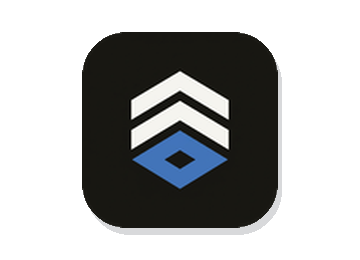
</p>

<h1 align="center" style="margin-top: 0.6rem; margin-bottom: 0.4rem;">livery (<code>liv</code>)</h1>

<p align="center">
  <a href="https://liv.bowd.io"></a>
  <a href="LICENSE"></a>
  <a href="https://github.com/bowd/livery/releases"></a>
  
  
  <a href="https://github.com/runkids/skillshare"></a>
</p>

<p align="center">
  <strong>Your AI agent fleet, in uniform.</strong><br>
  Declarative multi-host environment orchestration, two-way SSH sync, nested Skillshare dashboards,<br>
  ranked prompt fragments, multi-account Shadow Homes, and native Herdr launching.
</p>

<p align="center">
  <a href="https://liv.bowd.io">Website</a> •
  <a href="#why-livery">Why Livery</a> •
  <a href="#live-tour--feature-preview">Tour &amp; Screenshots</a> •
  <a href="#installation">Install</a> •
  <a href="#quick-start">Quick Start</a> •
  <a href="#feature-deep-dive">Features</a> •
  <a href="#documentation">Docs</a>
</p>

<p align="center">
  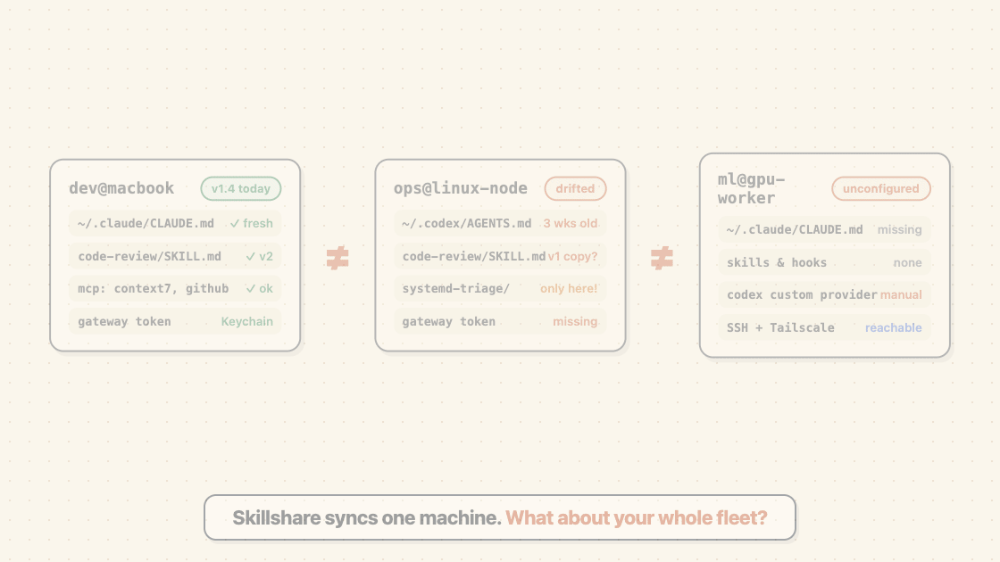
</p>

---

## Why Livery

[**Skillshare**](https://github.com/runkids/skillshare) solves keeping skills, MCP servers, hooks, and agents unified across AI coding tools **on a single machine**.

Once you work across **a MacBook, headless Linux / NixOS servers over SSH, and multiple accounts/gateways** (Claude Enterprise Gateway + Personal Max, OpenAI OAuth + custom coding providers), a new layer of drift appears:

- **Host & role divergence** — Your laptop needs browser QA skills and desktop notifications; your Linux servers need read-only Postgres MCP, NixOS diagnostics, and production guardrails.
- **Stranded remote edits** — You tweak a skill or add an MCP server while SSH'd into a Linux box, and your central repo immediately falls behind.
- **Prompt bloat & divergence** — `~/.claude/CLAUDE.md` and `~/.codex/AGENTS.md` drift out of sync or balloon past attention budgets.
- **Multi-account friction** — Running two Claude or Codex accounts normally means choosing between clobbering OAuth credentials or losing shared skills and session memory.

**Livery (`liv`)** sits cleanly one layer above stock `skillshare` as a single static Go binary (`CGO_ENABLED=0`) backed by a Git-native XDG control plane (`~/.local/share/livery`):

- **Environment Management & Auto-Discovery** — Discover machines from Tailscale, Herdr, and `~/.ssh/config`, probe OS/NixOS/harnesses with zero remote prerequisites, and bootstrap static `liv` + `skillshare` over SSH in one command.
- **Composable Profiles & Fleet Matrix** — Layer reusable profiles (`base` → `workstation`, `server-ops`) and toggle per-host overrides in an interactive `Items × Environments` Matrix.
- **Live Nested Skillshare (Local & SSH-Tunneled)** — Embeds stock `skillshare ui` directly inside `liv ui` — sandboxed for your central **Catalog**, Read/Write for local, and **tunneled live over SSH** (`-L` loopback + stdin-EOF watchdog) for remote Linux machines.
- **True Two-Way Sync (`liv sync` & `liv pull`)** — Every outward push snapshots a `livery-base` Git tag on the target. Edits made directly on any host light up live via SSE and pull cleanly back into your Catalog, Matrix, or host-only overrides.
- **Ranked Prompt Fragments** — Author modular `+++` Markdown prompt blocks once, rank them globally (`#1..#N`) with live word-budget tracking, and compile provider-filtered `~/.claude/CLAUDE.md` and `~/.codex/AGENTS.md` files per host.
- **Multi-Profile Launcher & Shadow Homes (`liv <harness> <profile>`)** — Direct `execve` launcher for `claude`, `codex`, `opencode`, `openclaw`, and `agy` with **Shadow Homes**, shared memory/session groups (`work` / `personal`), OS Keychain secrets, and `HMAC-SHA256` cross-host secret parity.
- **Native Herdr, T3 Code & OpenClaw Integration** — Ships an embedded **Herdr** `livery-launcher` mod (`Cmd+Shift+N`: `Space → Profile → Launch`) plus T3 Code and OpenClaw profile sync.

---

## Live Tour & Feature Preview

<p align="center">
  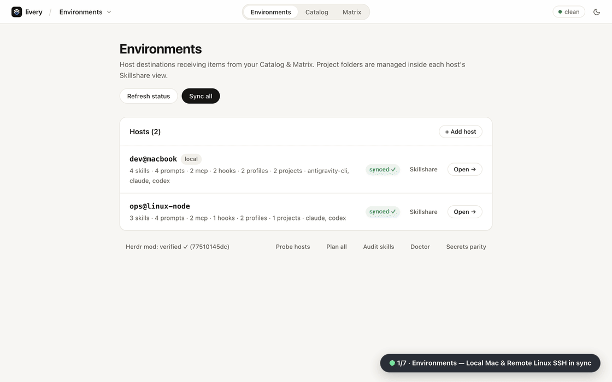
</p>

| Environments & Fleet Health | Host Overview & Native Discovery |
|---|---|
| 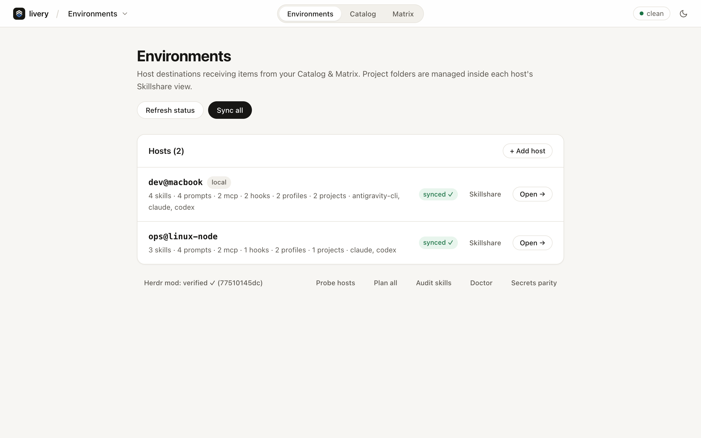 | 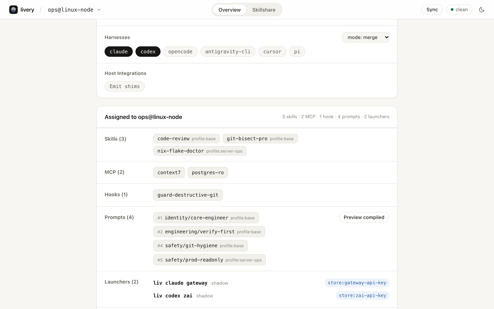 |

| Nested Skillshare Tunneled Live over SSH | Two-Way Sync (Pull Remote Edits → Catalog) |
|---|---|
| 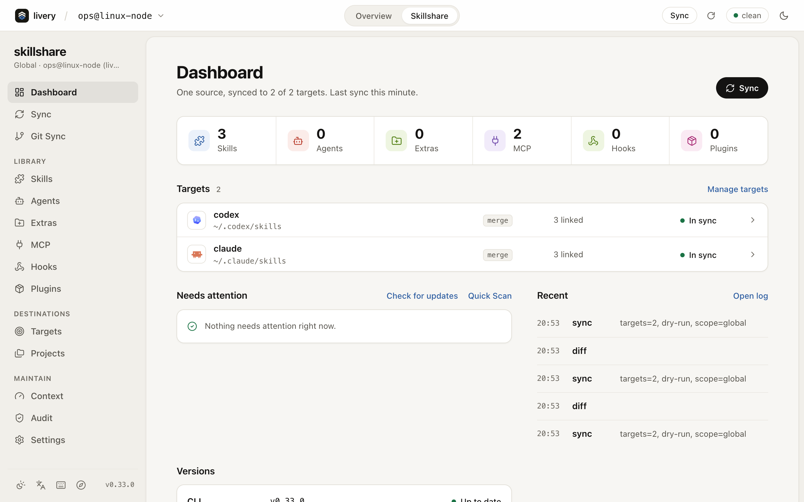 | 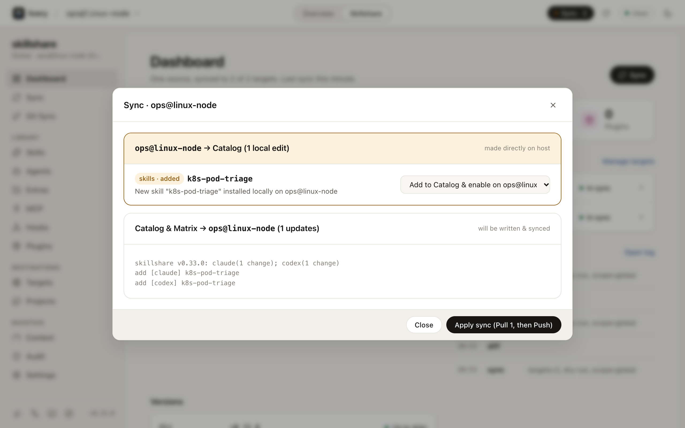 |

| Composable Fleet Matrix (`Environments × Profiles`) | Ranked Prompt Fragments & Built-In Git Diff |
|---|---|
| 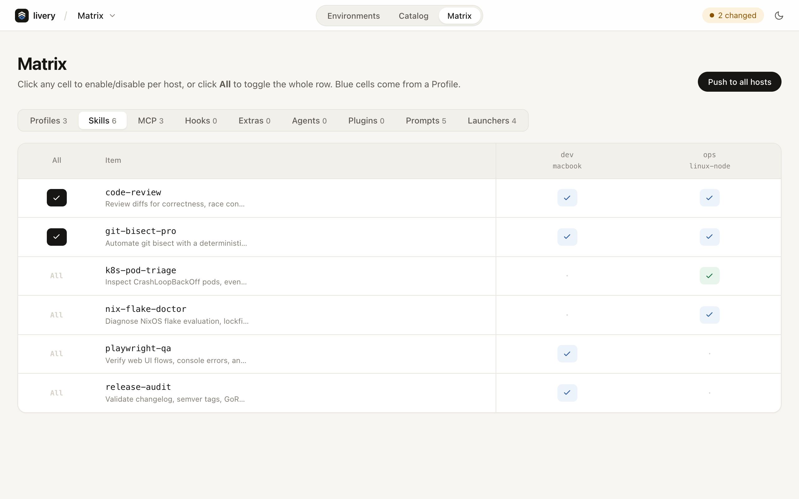 | 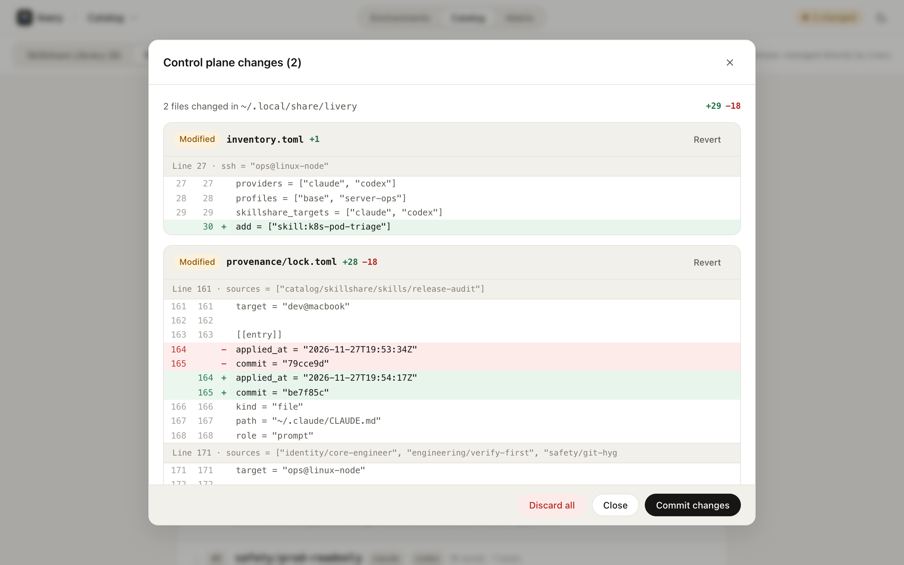 |

| Ranked Prompt Library (`CLAUDE.md` & `AGENTS.md`) | Multi-Profile CLI Launcher & Herdr Wizard |
|---|---|
| 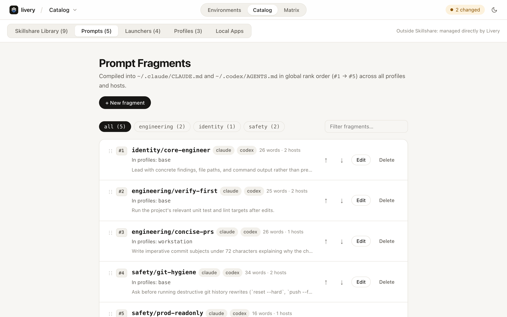 | 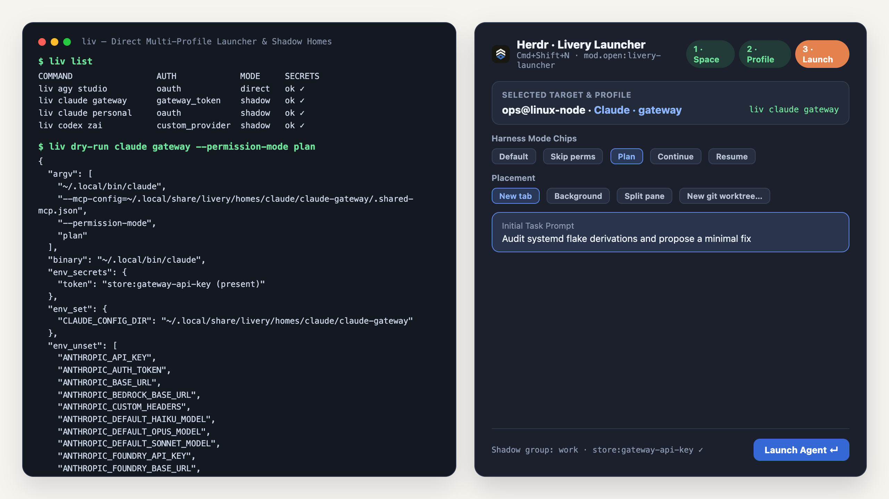 |

---

## Installation

### Shell Installer (macOS & Linux — SHA-256 verified)

```bash
curl -fsSL https://raw.githubusercontent.com/bowd/livery/main/install.sh | sh
```

Installs the static `liv` binary to `~/.local/bin/liv` without `sudo`. Install stock [`skillshare`](https://github.com/runkids/skillshare) alongside it for skill distribution and embedded dashboards:

```bash
brew install skillshare
# or on Linux:
curl -fsSL https://raw.githubusercontent.com/runkids/skillshare/main/install.sh | sh
```

### Go Install

```bash
CGO_ENABLED=0 go install github.com/bowd/livery/cmd/liv@latest
```

### Nix Flake (NixOS & macOS)

```bash
nix profile add github:bowd/livery
```

### Build from Source

```bash
git clone https://github.com/bowd/livery.git
cd livery
make install   # Atomically installs static binary to ~/.local/bin/liv
```

---

## Quick Start

```bash
# 1. Run guided onboarding & health checks (harnesses, secrets, skillshare, Herdr mod)
liv onboard --apply

# 2. Discover local, Tailscale, Herdr & ~/.ssh/config hosts and bootstrap a remote box
liv env discover
liv env add ops@linux-node --profiles base,server-ops
liv env bootstrap ops@linux-node --skillshare

# 3. Open the Livery Meta-UI (Environments · Catalog · Matrix · Nested Skillshare)
liv ui

# 4. Preview & push compiled configs, prompts, skills, MCP, hooks & launchers
liv plan
liv sync

# 5. Launch multi-account agent profiles directly (all trailing flags pass verbatim!)
liv claude gateway --permission-mode plan
liv claude personal --continue
liv codex zai --full-auto
```

---

## Feature Deep Dive

### 1. Environment Management & Zero-Prereq SSH Bootstrap
Livery treats every local and remote OS user (`dev@macbook`, `ops@linux-node`, `ml@gpu-worker`) as a declarative target in `~/.local/share/livery/inventory.toml`.
- **Auto-discovery** aggregates candidates from your local machine, Herdr (`hc machine ls`), Tailscale (`tailscale status`), and `~/.ssh/config`.
- **Zero-prereq POSIX probing** (`liv env probe`) inspects OS/arch, NixOS (`/etc/NIXOS`), installed harnesses, and existing skills using pure POSIX `sh` — safe even when the remote user's login shell is `fish` or lacks `en_US.UTF-8` locales.
- **One-step bootstrap** (`liv env bootstrap <id> --skillshare`) cross-compiles `liv` (`CGO_ENABLED=0`) for the remote architecture, streams it atomically to `~/.local/bin/liv`, and installs upstream `skillshare`.

### 2. Nested Skillshare & True Two-Way Sync
Instead of reinventing Skillshare's package manager or audit engine, `liv ui` orchestrates dedicated `skillshare ui` subprocesses ("slots") behind a single CSRF-protected reverse proxy:
- **Catalog Slot (`/catalog/skillshare`)** — Runs inside a sandboxed `$HOME` against `catalog/skillshare/config.yaml` (`targets: {}`) so you can install, edit, and security-audit your full library without touching live local harnesses.
- **Live Remote SSH Tunnel (`/env/<host>/skillshare`)** — Launches the remote host's own `skillshare ui` over a managed SSH loopback tunnel (`-L`) with a stdin-EOF watchdog that terminates the remote process immediately when idle or closed.
- **Two-Way Sync (`livery-base`)** — Outward pushes (`liv sync`) tag each host's Skillshare Git repo as `livery-base`. Edits made directly on a host are detected automatically (`liv drift` / SSE `Sync · ↑1`) and can be pulled into the shared Catalog, forked, or saved as a host-local override (`env-overrides/<host>.yaml`).
- **Native & External Importer** — Scans `~/.claude` and `~/.codex` on any host for pre-existing unmanaged skills, MCP servers, hooks, and plugins so you can adopt them into Livery or mark them `external` (`external = ["mcp:ide-*"]`).

### 3. Ranked Prompt Fragments (`CLAUDE.md` & `AGENTS.md`)
Keep always-loaded instructions sharp, deduplicated, and within context budgets:
- Store reusable prompt blocks under `prompts/fragments/<area>/<name>.md` with `+++` TOML frontmatter (`providers = ["claude", "codex"]`, `why`, `since`).
- Set deterministic global order in `prompts/order.toml` (or drag/reorder in **Catalog → Prompts** while watching per-fragment word counts).
- Livery compiles only the fragments enabled for each host's profiles into `~/.claude/CLAUDE.md` and `~/.codex/AGENTS.md`, plus optional per-project overlays (`projects/<target>/<slug>/`).

### 4. Multi-Profile Harness Launcher, Shadow Homes & Secrets
Run multiple subscriptions, enterprise gateways, and custom model providers side-by-side with zero wrapper shims:
- **Direct `execve`**: `liv claude gateway ...` scrubs conflicting ambient API keys, configures the profile's home, and `execve`s into `claude` with zero argument mangling.
- **Shadow Homes (`mode = "shadow"`)**: Symlinks shared skills, hooks, MCP servers, and rendered prompt files from your primary home while isolating OAuth state, `apiKeyHelper`, and provider configs per profile.
- **Session Groups (`liv group`)**: Share conversation history and project memories across selected profiles (e.g. `session_group = "work"` vs `"personal"`).
- **Keychain & SSH Secret Parity (`liv secret` / `liv secrets`)**: Store keys in macOS Keychain or `0600` Linux files via symbolic `store:<name>` refs. `liv secrets status` verifies exact byte parity across SSH hosts via salted `HMAC-SHA256` without exposing secret values; `liv secrets sync` propagates missing secrets over SSH stdin.

### 5. Native Herdr Launcher Mod (`Cmd+Shift+N`)
If you use **Herdr**, `liv herdr install-mod` installs the embedded `livery-launcher` mod and binds `Cmd+Shift+N` to a keyboard-first 3-step launcher (`Space → Profile → Launch`):
- Queries `liv list --json` live on whichever local or remote machine owns the selected Herdr space.
- Supports `Cmd+Enter` quick launch, harness-specific flag chips (`Skip perms`, `Plan`, `Full auto`, `YOLO`, `Continue`, `Resume`), custom task prompts, split/background/worktree placement, and `agent-folders` filing.
- `liv apps` also syncs launcher profiles directly into Herdr `programs.json`/templates, **T3 Code** custom providers, and **OpenClaw** profiles.

---

## Documentation

- [**Architecture & Data Model**](docs/architecture.md) — `~/.local/share/livery` layout, `inventory.toml`, profiles, compilation pipeline, `livery-base` two-way sync, and backup/lockfile safety.
- [**CLI Reference**](docs/cli.md) — Every `liv` command, subcommand, and flag.
- [**Multi-Profile Launchers, Secrets & Herdr**](docs/launchers-and-secrets.md) — `direct` / `shadow` / `isolated` homes, session groups, `store:` Keychain secrets, `HMAC-SHA256` parity, and the Herdr `livery-launcher` wizard.
- [**Meta-UI & Nested Skillshare Guide**](docs/ui-and-skillshare.md) — Dashboard tour, SSH-tunneled Skillshare slots, Matrix guardrails, Native & External importer, and built-in Git diff/commit modal.
- [**Prompt & Skill Authoring Guidelines**](docs/prompt-guidelines.md) — Context-budget rules and Claude Code vs Codex CLI behavior matrix.

---

## License

[MIT](LICENSE) © bowd
