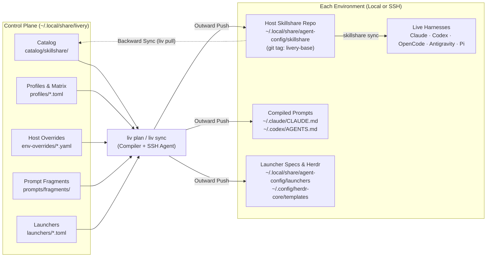

# Architecture & Data Model

Livery (`liv`) separates the **static CLI binary** from your **declarative fleet control plane**:

- **Binary**: `~/.local/bin/liv` (pure Go, `CGO_ENABLED=0`, embedded Meta-UI and Herdr `livery-launcher` mod)
- **Control Plane (`$LIVERY_HOME`)**: `~/.local/share/livery` by default (`$XDG_DATA_HOME/livery`, overridable via `--repo` or `$LIVERY_HOME` / `$LIVERY_REPO`)
- **Controller Runtime State**: `~/.local/state/livery` (sandboxed Catalog & preview state) and `~/.local/share/agent-config/homes` (Shadow & Isolated profile homes)

---

## Control Plane Directory Layout

```text
~/.local/share/livery/
├── inventory.toml                 # Environments ([[target]]) & fleet-wide [defaults]
├── catalog/
│   └── skillshare/                # Shared library (standalone git repo, targets: {})
│       ├── config.yaml            # Shared MCP servers, hooks, extras & library settings
│       ├── skills/<name>/SKILL.md # Shared skill definitions
│       └── agents/<name>.md       # Shared agent definitions
├── profiles/
│   ├── base.toml                  # Composable bundles (extends, skills, mcp, hooks,
│   ├── workstation.toml           #   plugins, agents, extras, prompts, launchers)
│   └── server-ops.toml
├── prompts/
│   ├── order.toml                 # Global fragment rank (#1 .. #N)
│   └── fragments/<area>/<name>.md # TOML +++ frontmatter + Markdown prompt blocks
├── launchers/
│   ├── claude-gateway.toml        # Multi-account harness profiles (`liv claude gateway`)
│   ├── claude-personal.toml
│   └── codex-zai.toml
├── env-overrides/
│   ├── dev@macbook.yaml           # Host-specific harness targets, projects & local overrides
│   └── ops@linux-node.yaml
├── projects/
│   └── <target>/<slug>/           # Optional per-project CLAUDE.md / AGENTS.md / .mcp.json overlays
└── provenance/
    ├── lock.toml                  # SHA-256 lockfile of every file & symlink managed per host
    └── matrix.md                  # Generated fleet coverage summary (`liv matrix`)
```

---

## Compilation Pipeline



---

## Core Schemas

### 1. Environments (`inventory.toml`)

Each `[[target]]` represents one OS user environment (`ssh = "local"` for the current machine, or `ssh = "user@host"` for any SSH-reachable Mac/Linux/NixOS machine):

```toml
[defaults]
provider_prompt_files = { claude = "~/.claude/CLAUDE.md", codex = "~/.codex/AGENTS.md" }
skillshare_root = "~/.local/share/agent-config/skillshare"
skillshare_mode = "merge"
external = ["mcp:ide-*"]

[[target]]
id = "dev@macbook"
ssh = "local"
providers = ["claude", "codex"]
profiles = ["base", "workstation"]
skillshare_targets = ["claude", "codex", "antigravity-cli"]
sync_herdr_programs = true
sync_herdr_templates = true
sync_t3_providers = true

[[target]]
id = "ops@linux-node"
ssh = "ops@linux-node"
providers = ["claude", "codex"]
profiles = ["base", "server-ops"]
skillshare_targets = ["claude", "codex"]
```

### 2. Composable Profiles (`profiles/<id>.toml`)

Profiles bundle items across every category and support multiple inheritance via `extends`:

```toml
id = "workstation"
description = "Interactive laptop setup with browser QA and multi-account launchers"
extends = ["base"]
mcp = ["github"]
hooks = ["notify-turn-complete"]
launchers = ["claude-gateway", "claude-personal", "codex-zai"]

[prompt]
fragments = ["engineering/concise-prs"]

[skills]
include = ["playwright-qa", "release-audit"]
```

Per-host tweaks without editing shared profiles are stored on the target (`add = [...]` / `remove = [...]` in `inventory.toml` and `env-overrides/<id>.yaml`), editable inline in the **Matrix** tab.

### 3. Ranked Prompt Fragments (`prompts/fragments/<area>/<name>.md`)

Prompt fragments use `+++` TOML frontmatter so Livery can filter by provider (`claude`, `codex`), track why each rule exists, monitor word budgets, and assemble them in deterministic global order (`prompts/order.toml`):

```markdown
+++
id = "engineering/verify-first"
providers = ["claude", "codex"]
scope = "user"
why = "Ensure test suites and linters run before declaring work done"
since = "2026-11-01"
+++
## Verification
- Run the project's relevant unit test and lint targets after edits.
- Fix root causes instead of suppressing warnings or skipping assertions.
```

---

## Two-Way Sync & Safety Guarantees

1. **Git-Backed Host Baseline (`livery-base`)**: Every environment's `~/.local/share/agent-config/skillshare` directory is initialized as its own lightweight local Git repository. Whenever `liv sync` pushes compiled items to a host, it commits the clean state and advances the `livery-base` Git tag.
2. **Exact Drift Detection (`liv drift`)**: If you install, edit, or delete a skill, MCP server, or hook directly on a remote host (either via CLI or Livery's SSH-tunneled Skillshare UI), Livery diffs the host's live tree against `livery-base` and classifies every change (`skill`, `mcp`, `hook`, `target`, `project`).
3. **Granular Backward Sync**: When pulling host edits back, you choose per item whether to:
   - **Import / Update Catalog** (promote to the shared library and fan out to other hosts on next push),
   - **Fork as Host Copy** in Catalog,
   - **Save as Host-Only Override** (`env-overrides/<id>.yaml`), or
   - **Disable on Host** in the Matrix.
4. **Unmanaged Path Protection & Automatic Backups**: `liv plan` / `liv sync` checks every target path against `provenance/lock.toml`. It refuses to clobber pre-existing unmanaged files unless explicitly adopted (`adopt = [...]`), and backs up modified or retired managed paths under `~/.local/share/agent-config/backup/<timestamp>/`.
5. **Zero-Prerequisite POSIX Probe & Fish-Safe SSH**: Remote probing (`liv env probe`) uses pure POSIX `sh` before `liv` or `skillshare` is even installed, strips noisy remote `setlocale` warnings (`LC_ALL=C.UTF-8`), and wraps SSH commands safely for `bash`, `zsh`, `dash`, and `fish` login shells alike.
